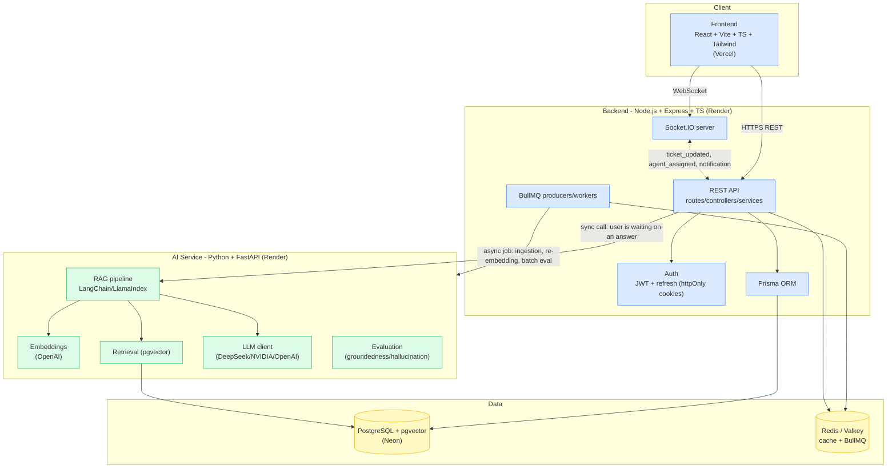

# Architecture - AI-Powered Customer Support Platform

This document records the current service boundaries and the implementation
state verified in the repository and Docker Compose environment.

## System diagram

## Ownership boundary (Operating Rule 3)

- **Node owns application state**: users, tickets, conversations, auth,
  role-based access control. Every write to these entities goes through
  Node/Prisma - the AI service never writes to these tables directly.
- **Python owns AI processing only**: embeddings, retrieval, LLM calls,
  RAG orchestration, groundedness/hallucination evaluation. It can *read*
  the knowledge-base/pgvector tables it needs for retrieval, but it does
  not own conversation or ticket state.
- Node calls the AI service over HTTP (sync, request/response) for
  in-the-moment chat replies, and enqueues BullMQ jobs (async) for work
  the user isn't blocked on (ingestion, re-embedding, batch evaluation
  runs). See `docs/ai.md` for the reasoning behind each choice as it's
  made, phase by phase.

## Deploy targets

- Frontend -> Vercel
- Backend and AI service -> Render free Web Services (Docker)
- PostgreSQL + pgvector -> Neon free
- Redis / BullMQ -> flat-rate Redis with `noeviction` (Aiven Valkey free
  preferred; Redis Cloud free fallback)

Render free services sleep after inactivity and cold-start on the next
request. The deployment plan accepts that behavior: chat has the existing
15-second timeout plus human escalation, and ingestion has a multi-attempt
BullMQ retry budget. See `docs/deployment.md`.

## Status

The backend currently exposes `/api/health`, the authentication routes
`/api/auth/register`, `/login`, `/refresh`, `/logout`, and `/logout-all`, plus
the authenticated profile route `/api/users/me` and customer-scoped
conversation and customer-message routes under `/api/conversations`.
Customer messages call Python's `/api/chat` synchronously; Node remains the
only writer of conversation and message application state.
Authentication is Docker-verified: access JWTs are signed, refresh tokens are
stored as SHA-256 hashes in PostgreSQL, refresh rotates the token, and logout
revokes it. Each refresh JWT includes a random `jti` so tokens issued for the
same user in the same second remain distinct; `jti` is not the Prisma row ID.

The backend runs on port 4000, the AI service on 8000, and the frontend on
5173 in Docker Compose. The production AI image binds `${PORT:-8000}`; the
backend reads `PORT` from the environment and defaults to 4000. Knowledge
document creation persists `PENDING`, writes a submission audit, and enqueues
asynchronous ingestion with a deterministic job ID; the AI service performs
bounded paragraph-aware chunking. Ingestion uses four BullMQ attempts with
exponential backoff, and the AI service only marks a document `FAILED` on the
final attempt. The worker also reconciles a still-unfinished document to
`FAILED` if the final HTTP attempt is aborted before the AI service can update
it. Provider-backed embeddings and pgvector writes use
`text-embedding-3-small` and are validated at 1536 dimensions. Chat can use
OpenAI, DeepSeek direct (`deepseek-flash`), or an OpenAI-compatible provider
such as NVIDIA Build; embeddings always use OpenAI and therefore require
`OPENAI_API_KEY` independently. Retrieval only uses chunks whose document is
both ingestion `READY` and moderation `APPROVED`, with a conservative degraded
fallback that now logs the failure instead of failing silently.

The AI service exposes `/api/health` as a dependency-free liveness probe and
`/api/ready` as a readiness probe that checks the database connection and the
presence of an embeddings key. Render health checks use `/api/health` so a
sleeping Neon database does not make the service appear dead.

Socket.IO authenticates access JWTs during connection, places clients in private
user rooms, and provides server-side emitters for `ticket_updated`,
`agent_assigned`, and `notification`. Resource-specific room authorization is
enforced against conversation ownership and ticket customer or active assignment
before room joins (admins may subscribe to any conversation or ticket); the
frontend exposes a reusable client and event hook. Express and Socket.IO read
the same comma-separated `CORS_ORIGIN` value; the AI service reads a JSON-list
`CORS_ORIGINS` value. Deployed Vercel origins are supplied through environment
variables with no per-deploy code changes.

Operational state is Node-owned. Moderation transitions use
`moderationVersion` for optimistic concurrency and audit in the same
transaction; ingestion retry is claimed before enqueueing and restores `FAILED`
if enqueueing fails. Ticket assignment/status changes and admin user updates are
transactional with audits. Ticket `resolvedAt` is maintained across resolve,
close, reopen, and re-resolve transitions. Analytics exposes an inclusive UTC
time-series and summary, and the admin audit view applies server-side filters
and an allowlisted metadata projection. The frontend operations dashboard
provides the time-series view, moderation queue/detail actions, and audit
filters for admins.

Local validation covers backend unit/integration tests, frontend build/lint,
AI tests/Ruff including a database-backed retrieval test, a clean migration, a
forward migration over legacy data, and the full isolated Playwright suite.
Hosted GitHub Actions run `40545993649` passed all five jobs on PR #1, and
post-merge `main` run `40590896540` passed all five jobs. Deployment
preparation is implemented, but no hosted Render/Neon/Vercel deployment has
been executed from this repository yet.
